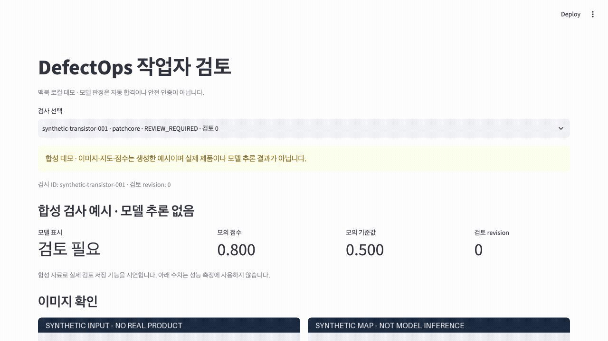
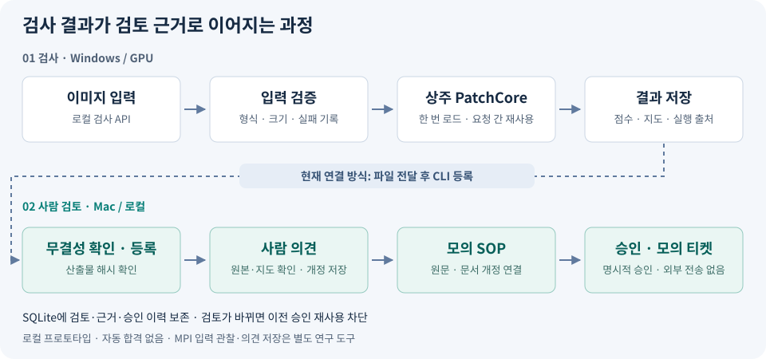
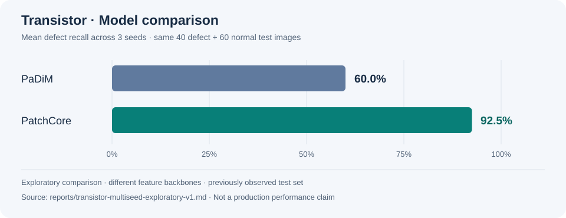

# DefectOps

### 정상 데이터로 이상을 찾고, 사람이 근거를 남기는 검사 워크플로우

**제조 이미지 이상탐지 모델의 실험부터 검사 API, 작업자 검토, 근거 문서와 승인 이력까지 구현한 ML 엔지니어링 프로젝트입니다.**
모델이 어디에서 틀리는지 분석하고, 제한된 GPU에서 실행할 수 있도록 만들며, 모델 출력과 사람의 판단을 구분해 기록합니다.

`Python` · `PyTorch / Anomalib` · `FastAPI` · `Streamlit` · `SQLite` · `pytest / GitHub Actions`

[대표 결과](#대표-결과) · [시스템 구조](#시스템-구조) · [실행하기](#실행하기) · [핵심 성과 3가지](docs/portfolio-highlights.md) · [5분 시연 절차](docs/demo-runbook.md) · [Apache-2.0](LICENSE)

> **현재 범위:** 공개 데이터 기반 연구·로컬 검토 프로토타입입니다. Transistor 검사·검토 흐름과 MPI-PCB 연구 도구를 구현했으며, 실제 생산 배포와 자동 합격 판정은 제공하지 않습니다. 문서 정리 기준: 2026-11-17.

## 23초 합성 시연

**합성 입력·지도 확인 → 관찰 의견 저장 → 내용 보완 → 두 개정의 보존 확인**



실제 Streamlit 화면을 조작하며 캡처한 단계별 GIF입니다. 그림·지도·점수는 생성한 예시이고 **모델 추론은 수행하지 않았습니다.** 의견 저장과 개정 이력은 실제 SQLite 기능으로 동작하며, 별도 데모 DB만 사용합니다.

[정지 화면·재현 방법](docs/synthetic-demo.md) · [합성 자료 생성 코드](scripts/prepare_synthetic_demo.py)

## 해결하려는 문제

제조 이상탐지는 불량 점수 하나로 끝나지 않습니다. 정상 외관의 변화에도 경고가 발생하고, 작은 결함은 높은 순위 지표에도 불구하고 놓칠 수 있습니다. 작업자가 결과를 다시 확인하려면 당시 모델·임곗값·이미지·검토 근거가 함께 남아 있어야 합니다.

| 문제 | 구현한 접근 |
| --- | --- |
| 어떤 모델을 선택할 것인가? | 같은 자료에서 검출·오경보·위치 반응·속도·메모리를 비교하고 실패 사례를 추적 |
| 제한된 장비에서 어떻게 실행할 것인가? | 모델 상주 추론, 대규모 특징 분할 처리, 중간 저장·재개, 저장 모델 재로딩 확인 |
| 사람이 판단한 근거를 어떻게 보존할 것인가? | 검토 개정 이력, SOP 원문 스냅샷, 같은 개정에 묶인 승인·모의 티켓 |

## 시스템 구조



검사 API가 같은 장비의 검토 DB에 결과를 자동 등록합니다. DB 등록 실패 시 산출물을 보존하고 같은 검사 ID로 재등록할 수 있습니다.

**연구실 Windows GPU에서 실제 이미지 1건의 검사 → 자동 등록 → 검토 의견 저장 → 모의 SOP 근거 연결을 확인했습니다.** 실행자의 확인에 따르면 `REGISTERED` 응답과 이미지 표시가 정상 동작했고, 검토 revision 1과 SOP 연결이 브라우저 새로고침 후에도 유지됐습니다. 이번 연결 사례의 승인·티켓 발행과 서버 재시작 후 복구는 아직 확인 전입니다. [확인 범위·실행·복구 방법](docs/api-review-integration.md)

MPI-PCB의 입력 관찰·의견 저장 도구는 이 흐름과 **분리된 연구 도구**이며 서비스 모델을 교체하지 않습니다.

**기존 모델의 출처 연결도 단일 사례로 검증했습니다.** 개인정보를 정리한 Git 이력에서 모델·평가 원본을 보존한 채 Windows GPU 검사를 실행했고, 기존 결과와 원점수·임곗값·이상 지도 값이 정확히 일치했습니다. 검토 목록 자동 등록도 확인했습니다. [2026-11-17 회귀검증 근거와 범위](reports/history-privacy-lab-validation-2026-11-17.md)

## 대표 결과

### 1. 모델 선택: 정확도와 실패 사례를 함께 비교



| Transistor · 3개 seed 평균 | PaDiM 구성 | PatchCore 구성 |
| --- | ---: | ---: |
| 불량 검출률 · Recall | 60.0% | **92.5%** |
| 정상 오경보율 | 2.78% | **1.67%** |
| 이미지 AUROC | 0.9175 | **0.9911** |

- 같은 시험 자료 **불량 40장·정상 60장**에서 비교했습니다. PatchCore는 세 실행 모두 **37장 검출·3장 미탐·정상 1장 경고**로 판정이 동일했습니다.
- 평균 검출률 차이는 **32.5%p**입니다. 모델과 특징 추출기 구성이 함께 다르므로 알고리즘 하나의 독립 효과로 해석하지 않습니다.
- 이미 관찰한 시험 자료를 반복 사용한 **탐색 비교**이며, 세 seed가 독립 시험 데이터 세 개를 뜻하지 않습니다.

[3-seed 비교 근거](reports/transistor-multiseed-exploratory-v1.md) · [오류 사례와 warm 벤치마크](reports/padim-vs-patchcore-transistor-exploratory-v1.md)

### 2. 실행 구조: 대규모 정상 특징을 8GB GPU 환경에서 처리

MPI-PCB 연구에서는 정상 학습 사진 256장으로부터 추출한 **3,145,728개 특징 후보**를 처리해 **78,643개 대표 특징**을 구성했습니다. 특징을 디스크·CPU에 보관하고 나누어 처리하며, 장시간 대표 선정의 진행 상태를 저장·재개하도록 구현했습니다.

| 원특징 공간 대표 선정 실험 | 연구실 측정 기록 |
| --- | ---: |
| 대표 선정·정상 보정·재로딩 | 약 14시간 30분 |
| PyTorch GPU reserved 최대 | **2.928GiB** |
| 프로세스 RAM RSS 표본 최대 | 13.413GiB |
| 사진 1장·12영역 warm 추론 평균 | 약 1.16초 |

GPU reserved는 장치 전체 메모리 사용량과 다릅니다. 1.16초는 모델 추론 측정이며 파일 저장·HTTP 응답을 포함하는 전체 서비스 지연시간은 아닙니다.

이 후보는 관찰한 불량 **55/55장**을 검출했지만 별도 정상 **15/256장**에 경고했고, 보정 표본 변화에도 취약했습니다. 좋은 고정 성적만으로 운영 모델을 채택하지 않고 연구 후보로 보존했습니다.

[자원·성능·보정 안정성 근거](reports/mpi-patchcore-raw-bank-v1-received-review.md) · [분할 실행 코드](scripts/mpi_patchcore_scaling_runtime.py) · [원특징 선정 실행기](scripts/run_mpi_patchcore_raw_bank.py)

### 3. 검토 흐름: 결과부터 승인 근거까지 추적

- FastAPI 시작 시 모델을 한 번 로드하고 요청에서 재사용합니다. 입력 오류와 추론 실패는 별도 기록으로 남깁니다.
- 작업자는 원본과 이상 지도를 비교하고 의견을 저장합니다. 수정은 이전 기록을 덮어쓰지 않고 **새 개정**으로 추가합니다.
- 선택한 SOP 개정·원문과 승인·모의 티켓을 같은 검토 개정에 연결합니다. 새 검토가 생기면 이전 승인을 재사용할 수 없습니다.
- 검토 저장 충돌과 모의 티켓 중복 요청을 처리하고, 산출물 해시를 확인합니다. 검사 API 자체의 중복 요청 방지와는 구분됩니다.

이전 수동 등록 사례에서는 실제 검사 결과 1건에 대해 **사람 검토 → 모의 SOP → 승인 → 모의 티켓**의 로컬 시연을 완료했습니다. 최근 API 자동 등록 사례는 SOP 연결까지 확인했으며, 두 사례의 검증 범위를 구분합니다. 외부 티켓 전송·현장 조치·사용자 인증은 범위 밖입니다.

[시연 완료 근거](reports/local-review-to-mock-ticket-demo-v1.md) · [검토 저장소](src/defectops/review_store.py) · [검사 API](src/defectops/inspection_api.py)

## 현재 구현 상태

| 구성 | 상태 | 범위 |
| --- | --- | --- |
| Transistor 검사 API | 구현·실제 이미지 확인 | 고정 PatchCore 모델, 단일 worker, 로컬 접속 |
| 작업자 검토·SOP·모의 티켓 | 구현·단일 사례 시연 완료 | Streamlit + SQLite, 동일 장비 API 자동 등록 지원 |
| 모델 비교와 GPU 실험 | 실행·보고서 보존 | MVTec AD, Real-IAD, VisA, MPI-PCB; 연구 조건별 결과 구분 |
| MPI 입력 관찰·의견 저장 | 로컬 구현 | 입력 상태·근거·작성자·개정 기록; 기존 서비스와 분리 |
| CPU 자동 검사 | CI 설정 구현 | push / PR에서 pytest; 실제 GPU 성능 검증과 분리 |
| 이력 정리 후 기존 모델 연결 | Windows GPU 단일 사례 회귀검증 완료 | 고정 커밋 대응표, 원본 보존, 점수·지도 일치; [호환 조건](docs/history-privacy-compatibility.md) |
| 검사와 검토의 자동 연결 | CPU 통합 검증·Windows GPU 단일 사례 확인 | API 자동 등록, 의견·SOP 연결 및 새로고침 후 유지 확인; 서버 재시작 복구는 로컬 테스트로 검증 |

현재 MPI 작업은 추가 학습보다 **부품이 보이지 않는 입력과 모델의 정상 오경보를 구분해 관찰 근거를 남기는 기능**에 집중합니다. 입력 확인 대상으로 분류했다고 기존 오경보를 제외하거나 정확도 향상으로 계산하지 않습니다. [입력 검토 기능과 사용법](docs/mpi-input-review-notes-v1.md)

## 실행하기

### 코드·CPU 테스트 확인

Python 3.11 이상이 필요합니다. 아래는 macOS / Linux 셸 기준이며, Windows에서는 `python3` 대신 `python`, 가상환경 활성화는 `.\.venv\Scripts\Activate.ps1`을 사용합니다.

```sh
python3 -m venv .venv
source .venv/bin/activate
python -m pip install -e '.[test]'
python -m pytest -q
```

이 경로는 모델 학습 없이 CPU 테스트를 실행합니다. [CI 설정](.github/workflows/tests.yml)도 같은 설치·테스트 명령을 사용합니다. GPU·외부 산출물이 필요한 검증은 해당 환경에서 별도로 실행합니다.

### 작업자 검토 화면

```sh
python -m pip install -e '.[data]' -r requirements/ui.txt
python scripts/review_inspections.py init
python scripts/serve_review_ui.py
```

브라우저에서 `http://127.0.0.1:8501`을 엽니다. **검사 산출물을 등록하기 전에는 실제 검사 사례가 표시되지 않습니다.** 데이터 이미지·모델·검토 DB는 저장소에 포함하지 않습니다.

### GPU 없이 합성 시연 실행

위 검토 화면 의존성을 설치한 뒤 저장소 루트에서 실행합니다. 실데이터·체크포인트가 필요하지 않습니다.

```sh
python scripts/prepare_synthetic_demo.py
python scripts/serve_review_ui.py --db artifacts/demo/synthetic-review-v1/reviews.sqlite3 --port 8781
```

`http://127.0.0.1:8781`에서 합성 사례를 확인하고 의견을 저장할 수 있습니다. 생성기는 기존 폴더를 덮어쓰지 않습니다. 다시 열 때는 두 번째 명령만 실행합니다. [초기화 없이 새 시연 만드는 방법](docs/synthetic-demo.md)

| 실행 목적 | 필요한 자료와 안내 |
| --- | --- |
| 실제 GPU 검사 | 고정 모델·평가 bundle, Windows CUDA 환경 → [검사 API 실행](docs/patchcore-local-api.md) |
| 이력 정리 전 모델 연결 | 전체 Git 이력과 지원되는 모델 묶음 → [CPU 사전 검증·실행 절차](docs/history-privacy-compatibility.md) |
| API 결과 자동 등록 | 같은 장비의 검토 DB → [실행·복구 절차](docs/api-review-integration.md) |
| 수동 산출물 가져오기 | 다른 장비에서 전달받은 검사 폴더 → [등록 절차](docs/review-store.md) |
| 검토부터 모의 티켓까지 시연 | 등록된 검사 결과 → [5분 시연](docs/demo-runbook.md) |
| MPI 입력 관찰 기록 | 지정 연구 ZIP → [별도 로컬 화면](docs/mpi-input-review-notes-v1.md) |

## 코드와 근거 둘러보기

| 위치 | 살펴볼 내용 |
| --- | --- |
| [`src/defectops/`](src/defectops/) | 검사 API, 입력 검증, 검토 저장소, SOP 및 UI 지원 코드 |
| [`scripts/`](scripts/) | 모델 실험·평가·진단·중단 재개·화면 실행 진입점 |
| [`configs/`](configs/) | 모델·데이터·평가 조건 |
| [`tests/`](tests/) | 입력 오류, 기록 무결성, 개정 충돌, 승인 조건, 계산 검증 |
| [`reports/`](reports/) | 측정 결과·오류 분석·후보 채택/비채택 근거 |
| [`docs/`](docs/) | 실행 방법, 실험 설계, 서비스 계약 |

## 적용 범위와 다음 개발

공개 데이터에서 확인한 결과를 실제 제조 환경의 성능으로 일반화하지 않습니다. 모델 출력은 결함 확률·심각도·제품 합격이 아니며, 자동 합격은 허용하지 않습니다. 로컬 작성자 이름은 자기 기입으로 인증된 신원이 아닙니다.

합성 자료 기반 공개 시연과 검사 결과 자동 등록·등록 재시도 기능을 구현했습니다. Windows GPU에서 자동 등록부터 의견·SOP 연결까지 단일 사례를 확인했습니다. 다음은 **같은 사례의 승인·모의 티켓 확인 → 서버 재시작 후 복구 확인 → 전체 응답 시간 측정 → 검사 요청 자체의 중복 방지**입니다. 모델 연구에서는 정상 오경보와 보정 불안정이 미해결 과제로 남아 있습니다.

데이터 이용·재배포 조건은 출처별로 구분합니다. 원본 이미지·마스크·체크포인트·실제 검토 DB는 코드와 분리해 보관합니다. [데이터 안내](data/README.md)

## 라이선스와 배포 범위

DefectOps 자체 코드·문서는 별도 표시가 없으면 **[Apache License 2.0](LICENSE)**을 적용합니다.
외부 코드의 기존 고지는 [NOTICE](NOTICE)와 [외부 코드·의존성 안내](THIRD_PARTY_NOTICES.md)에 정리했습니다.
SuperSimpleNet에서 옮긴 대조 구현은 원저자의 MIT 고지를 유지합니다.

데이터셋 이미지·마스크, 외부 사전학습 가중치, 연구실 체크포인트와 실제 검토 DB는
소스 배포에 포함하지 않습니다. 각각의 이용 조건은 코드 라이선스와 별도로 적용됩니다.

---

[이력서·면접용 핵심 성과](docs/portfolio-highlights.md) · [이전 README와 실험 진행 이력](docs/readme-history-through-2026-10-09.md)
