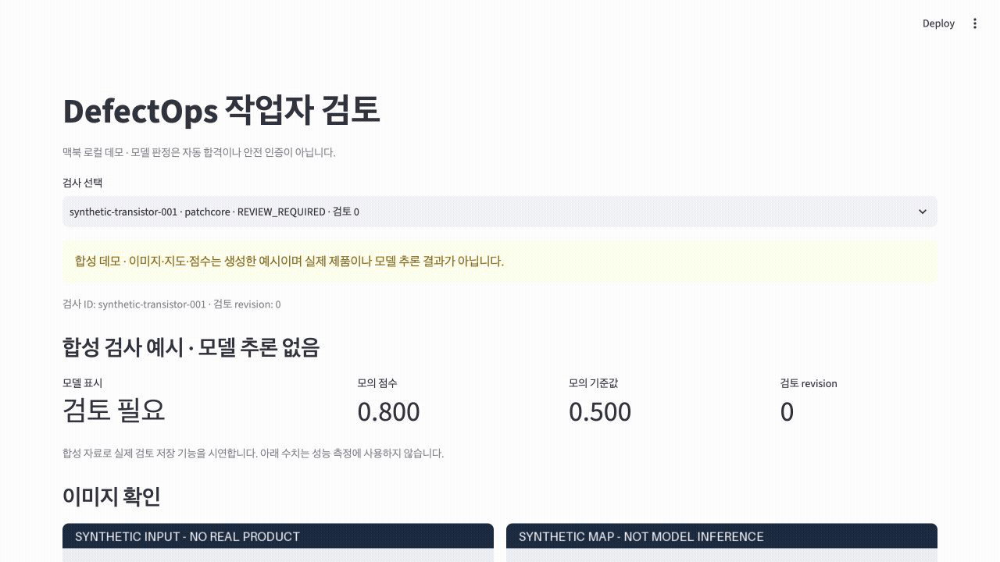

# GPU 없이 실행하는 합성 검토 시연

실제 `scripts/review_ui.py`와 `ReviewStore`를 사용하는 공개용 시연이다. 데이터셋 이미지·사람 이름·실제 검토 의견·모델 체크포인트는 포함하지 않는다. 그림, 반응 지도, 점수 0.8과 기준값 0.5는 화면 동작을 위한 생성 값이다. 모델 정확도나 실제 추론 속도를 보여주는 영상이 아니다.

## 짧은 시연



약 23초의 GIF는 브라우저에서 실제로 수행한 아래 단계의 캡처를 묶은 것이다. 연속 화면 녹화나 실제 처리 시간 측정이 아니다. 화면 내용은 조작하거나 합성하지 않았다.

1. `synthetic-transistor-001`의 합성 표시·모의 점수·검토 개정 0을 확인한다.
2. 합성 입력과 합성 반응 지도를 나란히 확인한다.
3. 작성자 `demo-reviewer`, 판단 보류, 그림에서 보이는 관찰 내용을 입력하고 확인 후 저장한다.
4. 첫 기록이 남아 있는 상태에서 관찰을 보완하고 다시 저장한다.
5. 개정 1과 2가 각각 남아 있고, 판단 보류 상태에서 모의 조치 근거가 제시되지 않는 것을 확인한다.

촬영 뒤 브라우저 새로고침에서도 개정 2 유지 여부를 확인했다. 이번 짧은 시연에는 SOP 선택·승인·티켓 발행이나 오래된 승인 거부 장면은 포함하지 않았다. 해당 흐름은 [전체 시연 절차](demo-runbook.md)를 참고한다.

## 정지 화면

움직이는 GIF를 보지 않아도 아래 이미지에서 확인할 수 있다.

| 단계 | 화면 |
| --- | --- |
| 합성 데이터 표시 | [초기 상태](assets/synthetic-demo/01-overview.jpg) |
| 입력·지도 비교 | [합성 그림과 지도](assets/synthetic-demo/02-images.jpg) |
| 첫 의견 입력 | [저장 전 양식](assets/synthetic-demo/03-form.jpg) |
| 관찰 보완 | [기존 기록과 수정 내용](assets/synthetic-demo/05-revise.jpg) |
| 수정 이력 보존 | [개정 1·2와 판단 보류](assets/synthetic-demo/06-history.jpg) |

## 직접 실행

저장소 루트에서 Python 3.11 이상을 사용한다. 가상환경을 활성화한 뒤:

```sh
python -m pip install -e '.[data]' -r requirements/ui.txt
python scripts/prepare_synthetic_demo.py
python scripts/serve_review_ui.py --db artifacts/demo/synthetic-review-v1/reviews.sqlite3 --port 8781
```

같은 컴퓨터에서 `http://127.0.0.1:8781`을 연다. Windows PowerShell에서도 활성화된 가상환경의 `python`으로 위 명령을 사용할 수 있다. 이 경로는 PyTorch·GPU·실데이터 다운로드가 필요 없다.

- 생성 위치: `artifacts/demo/synthetic-review-v1/`
- 별도 DB: 해당 폴더의 `reviews.sqlite3`
- 검사 기록: `source_kind=SYNTHETIC_DEMO`, `model_inference_performed=false`
- `model=patchcore`와 기존 비교 상태는 기존 bundle 스키마 호환을 위한 필드다. 실제 모델 실행 또는 과거 실험의 재현을 뜻하지 않는다. trace의 지문도 합성 표시 문자열의 해시이며 실제 체크포인트 해시가 아니다.
- 등록·이미지 무결성 검사·검토 개정 저장은 기존 앱 코드를 그대로 사용한다.
- 의견은 촬영용 가상 사용자의 합성 관찰이다. 현재 연구 자료의 사람 검토 이력으로 사용하지 않는다.

서버를 껐다 켜도 기록은 보존된다. 생성기는 기존 출력 폴더가 있으면 중단하며 DB를 지우거나 덮어쓰지 않는다. 기존 시연을 다시 열려면 서버 명령만 실행한다. 새 시연을 만들 때는 별도 이름을 사용한다.

```sh
python scripts/prepare_synthetic_demo.py --output artifacts/demo/synthetic-review-v2
python scripts/serve_review_ui.py --db artifacts/demo/synthetic-review-v2/reviews.sqlite3 --port 8781
```

기존 8781 서버는 먼저 정상 종료한다. 생성된 DB·산출물은 `artifacts/`에 남기고 Git에 올리지 않는다. 공개하는 것은 합성 화면 캡처와 생성 코드뿐이다.

## 검증

```sh
python -m pip install -e '.[test]'
python -m pytest tests/test_synthetic_demo.py tests/test_review_ui.py -q
```

합성 표시, 산출물 무결성, 재생성 시 덮어쓰기 거부, 실제 의견 저장·개정 보존 및 기존 검토 화면 동작을 확인한다. 이 테스트는 모델 성능 검증이 아니다.
